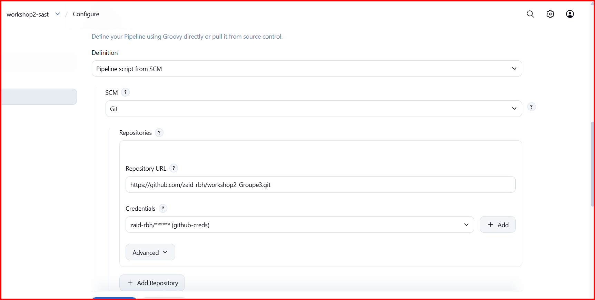
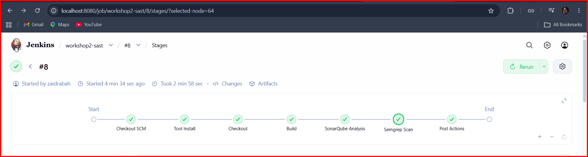
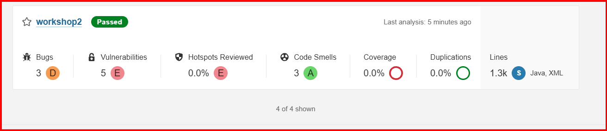
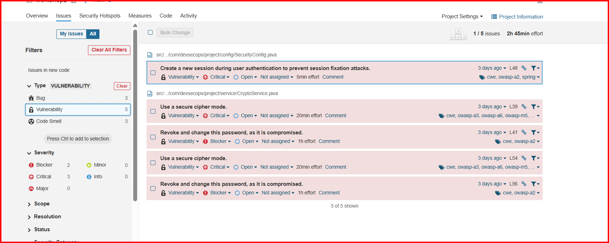
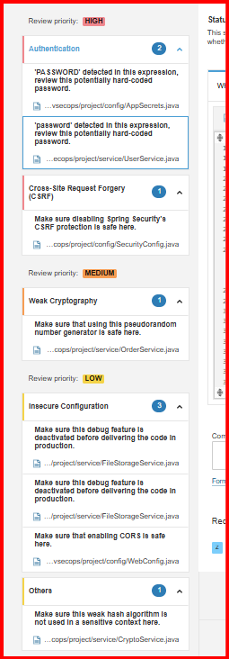
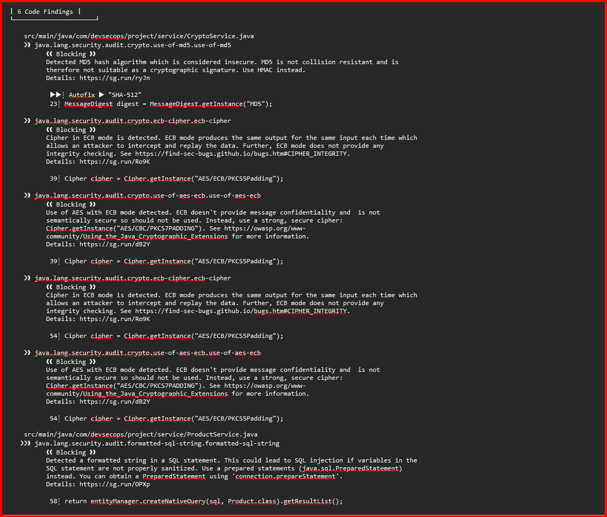
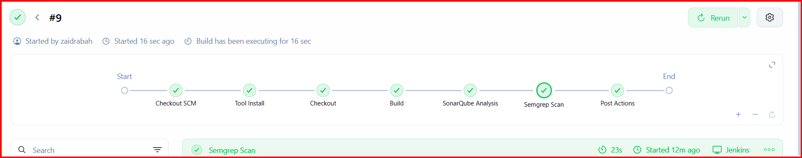
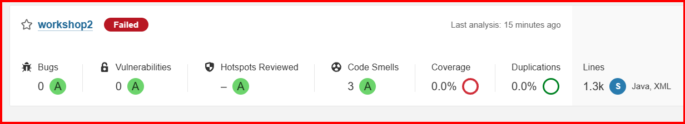
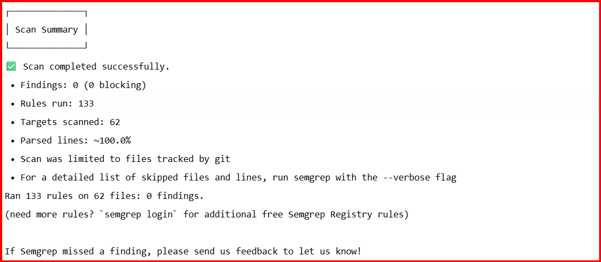

# Workshop 2 : Analyse SAST avec SonarQube et Semgrep

**Groupe :** GROUPE3
**Dépôt :** `workshop2-GROUPE3`

## Sommaire

1. [Installation rapide du projet](#1-installation-rapide-du-projet)
2. [Introduction au workshop](#2-introduction-au-workshop)
3. [Réalisation](#3-réalisation)
   - [3.1 Environnement et outils](#31-environnement-et-outils)
   - [3.2 Le pipeline Jenkins](#32-le-pipeline-jenkins)
   - [3.3 Résultats SonarQube](#33-résultats-sonarqube)
   - [3.4 Résultats Semgrep](#34-résultats-semgrep)
   - [3.5 Comparaison SonarQube vs Semgrep](#35-comparaison-sonarqube-vs-semgrep)
   - [3.6 Corrections des vulnérabilités](#36-corrections-des-vulnérabilités)
4. [Conclusion](#4-conclusion)

---

## 1. Installation rapide du projet

Le projet analysé est **VulnerableShop** : une petite boutique en ligne en Java / Spring Boot, **volontairement vulnérable**, créée pour un cours de DevSecOps.

> ### ⚠️ Volontairement vulnérable : à lancer uniquement sur sa propre machine
> Ne jamais le déployer sur un serveur, un réseau partagé ou sur Internet.
> L'application écoute uniquement sur `127.0.0.1` et utilise des données fictives.

**Prérequis :** JDK 21, Maven (ou IntelliJ IDEA) et une connexion Internet au premier lancement.

```bash
# 1. Vérifier Java (la version doit être 21)
java -version

# 2. Compiler le projet
mvn -B clean verify

# 3. Lancer l'application
mvn spring-boot:run
```

Quand la console affiche `Started DevSecOpsProjectApplication`, ouvrir **http://localhost:8080**.

**Avec IntelliJ :** `File > Open` (dossier contenant `pom.xml`) → `File > Project Structure` : SDK = JDK 21 → lancer `DevSecOpsProjectApplication` avec le ▶ vert.

### Comptes de démonstration (fictifs)

| Utilisateur | Mot de passe | Rôle |
|---|---|---|
| `admin` | `admin123` | Administrateur |
| `alice` | `alice123` | Client |
| `bob` | `123456` | Client |
| `charlie` | `qwerty` | Client |

Les pages d'administration sont sur http://localhost:8080/admin.

### Réinitialiser la base de données

Arrêter l'application, supprimer le dossier `data`, puis relancer :

```bash
rm -rf ./data
```

### Problèmes courants

| Problème | Solution |
|---|---|
| `java -version` n'affiche pas 21 | Installer JDK 21 et le sélectionner dans `Project Structure`. |
| `Port 8080 was already in use` | Fermer l'autre programme, ou ajouter `server.port=8081` dans `application.properties`. |
| `Database may be already in use` | Une exécution précédente tourne encore : l'arrêter puis relancer. |
| Erreur avec `requestMatchers` et plusieurs servlets | Ajouter `spring.h2.console.enabled=false` dans `application.properties`. |

---

## 2. Introduction au workshop

Ce workshop porte sur la **sécurité du code source** (analyse SAST, *Static Application Security Testing*). L'objectif est de :

- configurer une analyse SAST avec **SonarQube** (via Docker) et l'intégrer dans un pipeline CI ;
- utiliser **Semgrep** pour détecter des motifs de sécurité plus fins ;
- **comparer** les résultats des deux outils pour comprendre leurs limites, leurs complémentarités et leurs cas d'usage ;
- **corriger** les vulnérabilités trouvées.

Le projet analysé contient plusieurs vulnérabilités intentionnelles (injections, mauvaises pratiques cryptographiques, secrets codés en dur, configuration de sécurité faible).

### Organisation du groupe

Nous sommes un groupe de **3 étudiants** et nous travaillons sur **le même projet**. Pour ce workshop, **chaque membre a réalisé et testé l'ensemble de la chaîne d'analyse sur sa propre branche**, avec son propre pipeline Jenkins. Ce README est le rapport commun du groupe.

Pour consulter le pipeline (`Jenkinsfile`) d'un membre, il suffit d'ouvrir sa branche dans le dépôt :

| Membre | Branche |
|---|---|
| Zaid | zaid |
| saad | saad |
| soufiane |  |

---

## 3. Réalisation

### 3.1 Environnement et outils

| Élément | Rôle |
|---|---|
| **Jenkins** (conteneur Docker) | Exécute le pipeline CI : compilation, puis les deux analyses |
| **SonarQube Community** (conteneur Docker) | Analyse SAST complète, tableau de bord et notes de qualité |
| **Semgrep** (installé dans le conteneur Jenkins) | Analyse SAST par règles de motifs de code |

Jenkins et SonarQube sont placés sur un **réseau Docker commun** pour pouvoir communiquer. SonarQube est lancé ainsi :

```bash
sudo sysctl -w vm.max_map_count=524288

docker network create devsecops
docker network connect devsecops jenkins

docker run -d --name sonarqube --network devsecops \
  -p 9000:9000 \
  -v sonarqube_data:/opt/sonarqube/data \
  -v sonarqube_logs:/opt/sonarqube/logs \
  -v sonarqube_extensions:/opt/sonarqube/extensions \
  sonarqube:community
```

Côté Jenkins : installation du plugin **SonarQube Scanner**, ajout du token SonarQube dans les credentials (type *Secret text*, jamais en clair dans le code), déclaration du serveur SonarQube et de Maven dans la configuration.

Semgrep est installé dans le conteneur Jenkins pour pouvoir être appelé depuis le pipeline :

```bash
docker exec -u root jenkins bash -c "apt-get update && apt-get install -y python3 python3-venv && python3 -m venv /opt/semgrep-venv && /opt/semgrep-venv/bin/pip install semgrep && ln -sf /opt/semgrep-venv/bin/semgrep /usr/local/bin/semgrep"
```

### 3.2 Le pipeline Jenkins

Le pipeline est décrit dans le `Jenkinsfile` de la branche de chaque membre. Il suit les mêmes étapes :

1. **Checkout** : récupération du code depuis la branche du membre.
2. **Build** : compilation et vérification avec Maven (le projet compile sans erreur).
3. **SonarQube Analysis** : analyse du code avec le plugin Maven de SonarQube, résultats envoyés au serveur.
4. **Semgrep Scan** : analyse avec les règles `p/java` et `p/owasp-top-ten`, rapport archivé dans Jenkins.

Le job Jenkins est de type **Pipeline script from SCM** : il lit le `Jenkinsfile` sur la branche du membre.



Tous les stages s'exécutent avec succès :



### 3.3 Résultats SonarQube

Vue d'ensemble du projet après analyse :

| Indicateur | Valeur |
|---|---|
| Vulnérabilités | **5** (note E) |
| Bugs | **3** (note D) |
| Code smells | **3** (note A) |
| Security Hotspots revus | 0 % (note E) |
| Lignes analysées | 1,3k (Java, XML) |



**Vulnérabilités et bugs détectés :**

| Gravité | Type | Fichier:ligne | Problème |
|---|---|---|---|
| Critical | Vulnérabilité | `SecurityConfig.java:48` | Fixation de session |
| Critical | Vulnérabilité | `CryptoService.java:39` | Mode de chiffrement non sûr (ECB) |
| Blocker | Vulnérabilité | `CryptoService.java:41` | Mot de passe compromis codé en dur |
| Critical | Vulnérabilité | `CryptoService.java:54` | Mode de chiffrement non sûr (ECB) |
| Blocker | Vulnérabilité | `CryptoService.java:56` | Mot de passe compromis codé en dur |
| Major | Bug | `CartService.java:44` | Voir l'issue dans SonarQube |
| Major | Bug | `CartService.java:63` | Voir l'issue dans SonarQube |
| Major | Bug | `OrderService.java:44` | Voir l'issue dans SonarQube |



**Security Hotspots** (points à examiner manuellement) :

| Probabilité | Fichier:ligne | Problème |
|---|---|---|
| High | `AppSecrets.java:19` | Mot de passe potentiellement codé en dur |
| High | `UserService.java:27` | Mot de passe potentiellement codé en dur |
| High | `SecurityConfig.java:41` | Protection CSRF désactivée |
| Medium | `OrderService.java:44` | Générateur pseudo-aléatoire |
| Low | `FileStorageService.java:29`, `:48` | Fonctionnalité de debug à désactiver |
| Low | `WebConfig.java:19` | CORS activé |
| Low | `CryptoService.java:23` | Algorithme de hash faible (MD5) |



### 3.4 Résultats Semgrep

Semgrep a produit **6 findings**, soit **4 problèmes distincts** (chaque ligne ECB est signalée par deux règles) :

| Fichier:ligne | Règle | Problème |
|---|---|---|
| `CryptoService.java:23` | `use-of-md5` | Hash MD5 non résistant aux collisions |
| `CryptoService.java:39` | `ecb-cipher`, `use-of-aes-ecb` | AES en mode ECB |
| `CryptoService.java:54` | `ecb-cipher`, `use-of-aes-ecb` | AES en mode ECB |
| `ProductService.java:58` | `formatted-sql-string` | Injection SQL (requête native construite par concaténation) |

Le rapport s'affiche dans la console Jenkins et il est archivé comme artefact du build :



### 3.5 Comparaison SonarQube vs Semgrep

| Problème | Fichier:ligne | SonarQube | Semgrep |
|---|---|---|---|
| AES en mode ECB | CryptoService:39, :54 | Vulnérabilité (Critical) | Détecté (2 règles par ligne) |
| Clé/mot de passe codé en dur | CryptoService:41, :56 | Vulnérabilité (Blocker) | Non détecté |
| Mots de passe codés en dur | AppSecrets:19, UserService:27 | Hotspot (High) | Non détecté |
| Fixation de session | SecurityConfig:48 | Vulnérabilité (Critical) | Non détecté |
| CSRF désactivé | SecurityConfig:41 | Hotspot (High) | Non détecté |
| CORS | WebConfig:19 | Hotspot (Low) | Non détecté |
| Générateur pseudo-aléatoire | OrderService:44 | Hotspot (Medium) | Non détecté |
| Fonctionnalité de debug | FileStorageService:29, :48 | Hotspot (Low) | Non détecté |
| Hash faible MD5 | CryptoService:23 | Hotspot (Low) | Détecté (Blocking) |
| Injection SQL | ProductService:58 | Non détecté | Détecté (Blocking) |
| Bugs (3) | CartService:44, :63, OrderService:44 | Détectés | Non couvert |

**Analyse :**

- **SonarQube** est plus large : secrets codés en dur, configuration Spring Security (CSRF, sessions, CORS), bugs et qualité du code, avec un suivi et des notes (A à E).
- **Semgrep** est plus ciblé sur des motifs de code précis : il a détecté l'injection SQL que SonarQube n'a pas signalée.
- Les deux outils se complètent : les utiliser ensemble réduit les angles morts.
- **Cas d'usage :** SonarQube pour le suivi qualité/sécurité global du projet, Semgrep pour des règles de sécurité rapides et personnalisables, faciles à brancher dans un pipeline CI.

### 3.6 Corrections des vulnérabilités

| Fichier | Problème | Correction appliquée |
|---|---|---|
| `ProductService.java` | Injection SQL (mot-clé et `ORDER BY`) | Requête paramétrée (`:kw`) et liste de colonnes de tri autorisées (`name`, `price`, `stock`) |
| `CryptoService.java` | AES en mode ECB | AES-GCM avec un IV aléatoire à chaque chiffrement |
| `CryptoService.java` | Clé AES codée en dur | Clé lue depuis la variable d'environnement `APP_AES_KEY` |
| `CryptoService.java`, `SecurityConfig.java`, `UserService.java`, `DataInitializer.java` | Hash MD5 sans sel | Hachage des mots de passe avec BCrypt |
| `UserService.java` | Mot de passe écrit en clair dans les logs | Mot de passe et email retirés du log |
| `SecurityConfig.java` | Fixation de session | Changement de l'identifiant de session après la connexion (`changeSessionId`) |
| `SecurityConfig.java` | Protection CSRF désactivée | Protection CSRF réactivée (comportement par défaut de Spring Security) |
| `AppSecrets.java` | Secrets codés en dur dans le code source | Secrets retirés du code source |
| `OrderService.java` | Générateur pseudo-aléatoire prévisible | `SecureRandom` |
| `CartService.java` | `Optional.get()` sans vérification (2 bugs) | `orElseThrow` avec un message explicite |
| `WebConfig.java` | CORS ouvert à toutes les origines | Origine, méthodes et en-têtes restreints |
| `FileStorageService.java` | `printStackTrace()` | Journalisation avec un logger |

### Résultats après corrections

| Indicateur SonarQube | Avant | Après |
|---|---|---|
| Vulnérabilités | 5 (note E) | **0** (note A) |
| Bugs | 3 (note D) | **0** (note A) |
| Security Hotspots à revoir | 9 | **0** |
| Code smells | 3 (note A) | 3 (note A) |

**Semgrep après corrections :** 0 findings (avant : 6).

**Quality Gate :** elle reste en échec, sur **une seule condition**, la couverture de tests (0,0 % pour un minimum de 80 %). Les conditions de fiabilité, de sécurité, de maintenabilité et de duplications sont toutes validées. L'écriture de tests unitaires est hors du périmètre de ce workshop SAST.

Après les corrections, le pipeline est relancé pour vérifier le résultat.







---

## 4. Conclusion

Ce workshop a permis de mettre en place une chaîne d'analyse SAST automatisée dans Jenkins avec deux outils complémentaires. Les analyses ont révélé des problèmes de cryptographie, de gestion des secrets, de configuration de sécurité et d'injection SQL, qui ont ensuite été corrigés puis re-vérifiés dans le pipeline.
